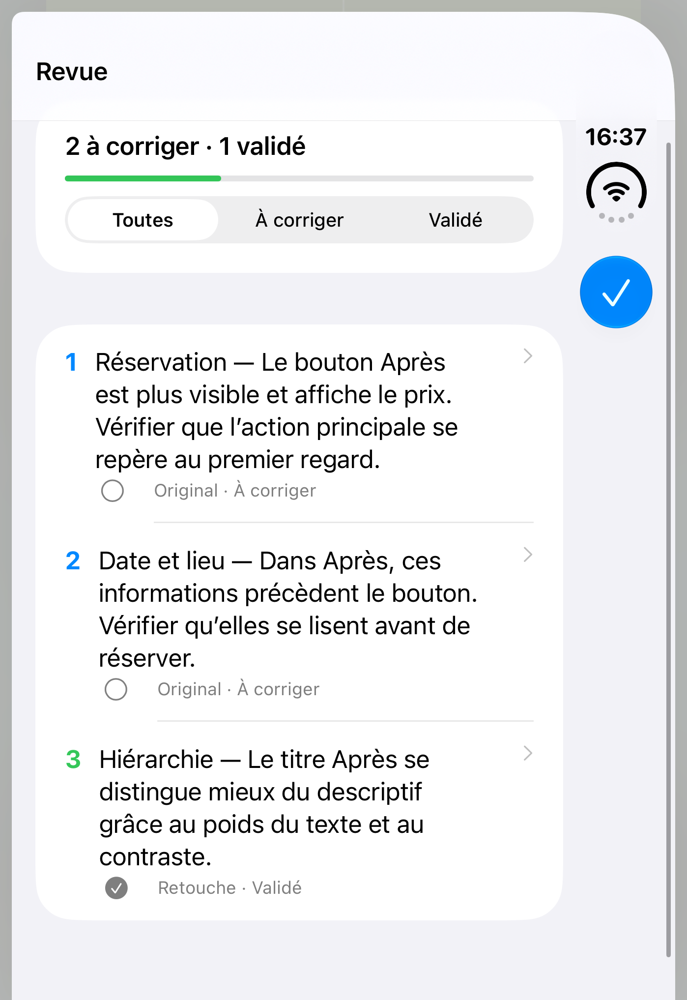
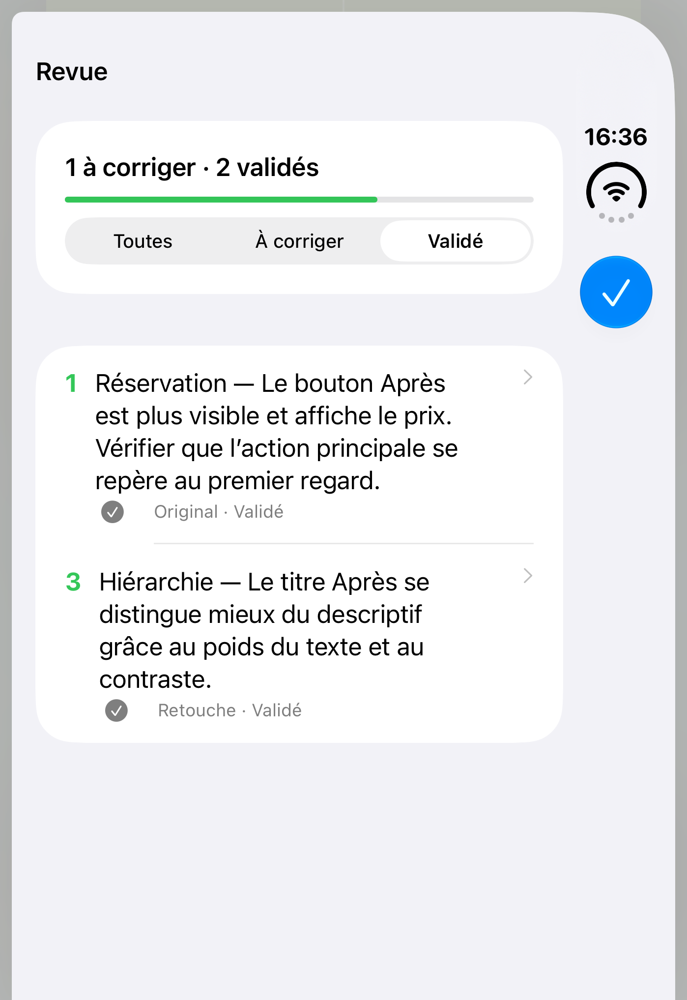
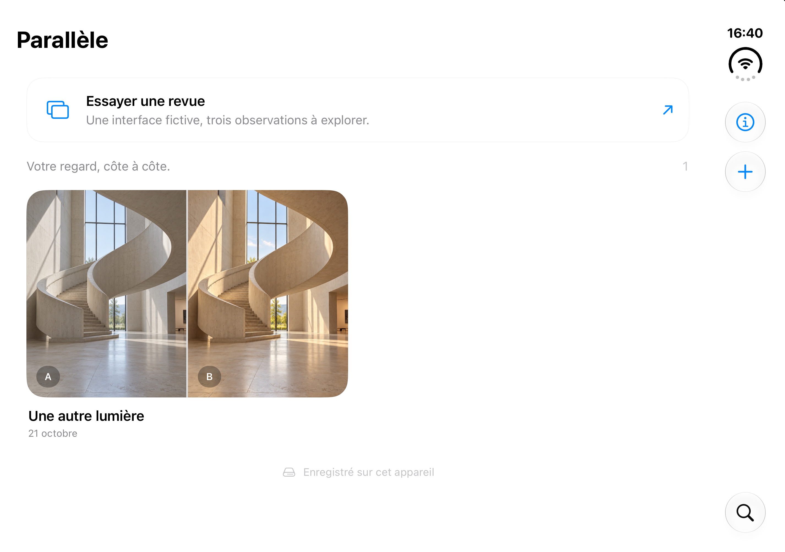

# Validation de la revue — 23 octobre 2026

Première évolution de Parallèle pour suivre une revue visuelle : exemple d’interface fictive, observations à corriger ou validées, filtres, sauvegarde et états repris dans l’export PNG.

## Environnement et résultats

Contrôle sur le simulateur **Parallèle — iPhone Duo**, iOS 27.1, avec Xcode 27.1. Les tests utilisent leur bibliothèque séparée ; la bibliothèque habituelle a été conservée.

| Passage | Résultat | Portée |
| --- | --- | --- |
| `review-01` | 20 réussites, 2 échecs | 16 tests unitaires et 4 parcours UI existants réussis. Les 2 nouveaux tests attendaient à tort que toutes les cellules de la liste existent hors écran. |
| `review-02` | 2 réussites, aucun échec | Nouveaux parcours rejoués après correction du test pour parcourir la liste et activer la recherche native. Notes d’exemple raccourcies et couleurs de liste ajustées avant ce passage. |

Les **22 tests distincts sélectionnés ont donc réussi** au terme de ces deux passages. Les résumés Xcode bruts sont conservés dans [Resultats-01.json](Revue-2026-10-23/Resultats-01.json) et [Resultats-02.json](Revue-2026-10-23/Resultats-02.json).

## Comportements vérifiés

- Création de l’exemple à la demande, sans import Photos, avec trois repères : deux à corriger et un validé.
- Conservation du projet déjà présent : titre et nombre d’annotations inchangés, aucune note d’exemple ajoutée à ce projet.
- Filtres Toutes, À corriger et Validé ; mêmes identifiants et numéros après changement de statut.
- Validation d’une observation, sortie de l’éditeur, arrêt complet puis relance de l’app : statut conservé ; réouverture de la correction possible.
- Lecture d’un ancien manifeste sans statut, modification et nouvelle sauvegarde sans perdre l’identifiant ni le texte du repère.
- Duplication des statuts avec des identifiants d’annotations indépendants.
- Parcours existants : annotation, modes de comparaison, import Photos, validation du formulaire et ouverture du partage PNG.
- Export d’un PNG lisible avec des annotations longues ; coordonnées, zoom et limites de déplacement couverts par les tests unitaires existants.

Le rendu de la nouvelle liste et les images fictives générées ont été inspectés. La bibliothèque a également été contrôlée sur l’écran intérieur après le passage à **Open** dans Device Hub.

## Captures

| Revue après redémarrage | Filtre des observations validées |
| --- | --- |
|  |  |



## Rejouer les nouveaux parcours

Depuis le dossier du projet, avec le simulateur dédié démarré :

```sh
xcodebuild -project Parallele.xcodeproj -scheme Parallele \
  -destination 'platform=iOS Simulator,name=Parallèle — iPhone Duo' \
  -only-testing:ParalleleUITests/ParalleleUITests/testReviewStatusFiltersAndSurvivesRelaunch \
  -only-testing:ParalleleUITests/ParalleleUITests/testReviewExampleCreatesSeparateProjectWithoutPhotoImport \
  -parallel-testing-enabled NO test
```

## Limites de ce contrôle

Les deux tests dédiés au redimensionnement et au pliage ont été exclus du passage `review-01`, pas comptés comme réussis. La campagne de mesure des repères en position fermée, ouverte et intermédiaire reste celle du [21 octobre](Validation-pliage-2026-10-21.md) ; elle n’a pas été rejouée ici. Aucun appareil physique n’a été testé.

La revue exprime une décision de l’utilisateur ; elle ne modifie pas les images. Cette évolution n’ajoute ni export PDF ni disposition d’atelier spécifique à la position semi-ouverte.
